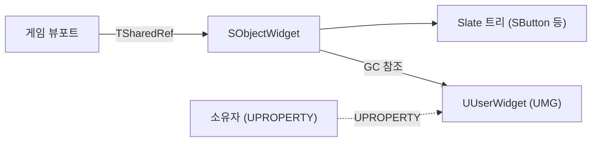
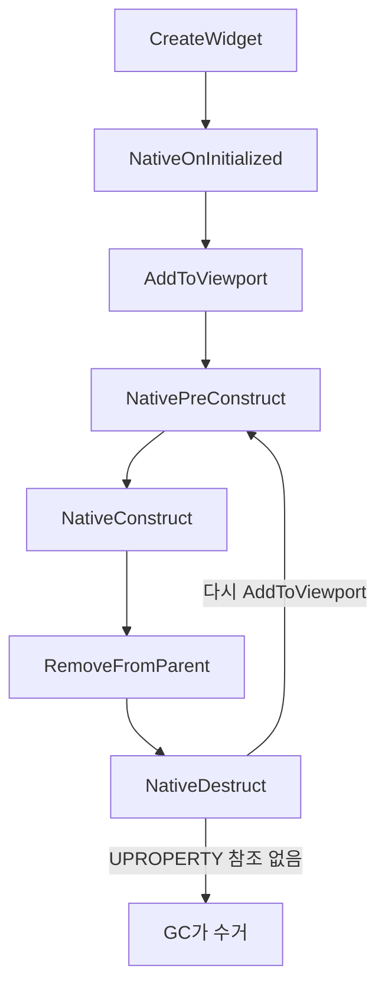
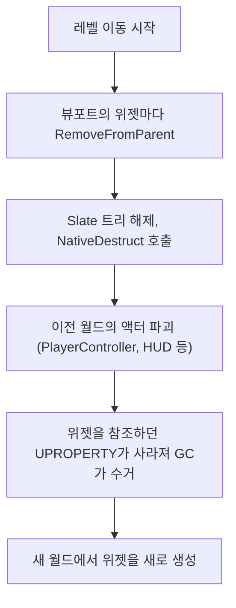

### 개요

---

UE에서 게임 UI를 만들면 UMG 위젯을 쓰지만, 화면에 실제로 그려지는 것은 그 UMG 위젯이 만든 Slate 위젯이다. 두 객체는 수명을 관리하는
방식이 달라서, 하나는 살아 있는데 다른 하나는 이미 해제된 상태가 생길 수 있다. 그래서 상태와 참조를 어느 쪽에 두느냐에 따라, 위젯을
다시 붙이거나 레벨을 이동할 때의 동작이 달라진다.

<br/>

### Slate와 UMG

---

Slate는 UE의 C++ UI 프레임워크이다. 언리얼 에디터의 창, 패널, 버튼은 모두 Slate로 그려지고, 게임 화면의 UI도 최종적으로는 Slate가
그린다. Slate 위젯은 UObject가 아닌 일반 C++ 객체다. 이름은 `S`로 시작하고(`SButton`, `STextBlock` 등), 수명은 GC가 아닌 
`TSharedPtr`/`TSharedRef`의 참조 수로 관리된다.

Slate 위젯은 `SNew`로 만든다. 아래 코드는 텍스트가 들어간 버튼을 만든다.

```c++
#include "Widgets/Input/SButton.h"
#include "Widgets/Text/STextBlock.h"

TSharedRef<SWidget> MakeStartButton()
{
    return SNew(SButton)
        [
            SNew(STextBlock)
            .Text(FText::FromString(TEXT("Start")))
        ];
}
```

Slate 위젯은 자식 위젯을 넣을 자리인 **슬롯**을 가진다. 대괄호 `[]`는 `operator[]`를 오버로딩한 것으로, 슬롯에 넣을 자식을
지정한다. 위 코드에서 `SButton`은 슬롯에 `STextBlock`을 자식으로 넣었다. 이렇게 부모와 자식으로 이어진 구조를 **위젯 트리**라고 
한다. `SVerticalBox`처럼 슬롯이 여러 개인 위젯은 자식을 여러 개 가질 수 있다.

부모는 슬롯에서 자식을 `TSharedRef`로 들고 있다. 그래서 트리의 루트가 살아 있으면 트리 전체가 살아 있다. 게임 화면에서는 게임 
뷰포트가 이 트리의 맨 위에 있고, `AddToViewport`는 위젯의 Slate 트리를 그 아래에 붙인다.

Slate는 위젯 트리를 따라 레이아웃, 그리기, 입력 처리를 한다. 이 과정은 기본적으로 매 프레임 반복된다. 레이아웃 단계에서는 자식부터
각 위젯이 원하는 크기를 계산하고, 부모가 그 크기를 보고 자식의 위치와 크기를 정한다. 그리기 단계에서는 배치가 끝난 위젯마다 사각형,
이미지, 텍스트 같은 그릴 요소를 만들어 렌더러에 넘긴다. 입력 처리 단계에서는 마우스 아래에 있는 위젯을 찾아 클릭을 전달하고, 키보드
포커스를 가진 위젯에 키 입력을 전달한다.

입력은 가장 안쪽 위젯부터 받고, 그 위젯이 처리하지 않으면 부모로 올라간다. 그래서 버튼 위에 다른 위젯을 겹쳐 두면 버튼이 클릭되지
않는다. 입력은 위에 있는 위젯과 그 부모로만 전달되고, 아래에 겹친 버튼은 그 경로에 없기 때문이다. 위 위젯의 Visibility를
`Not Hit-Testable (Self & All Children)`로 두면 입력이 아래 버튼에 전달된다. 위 위젯의 자식은 입력을 받아야 한다면 
`Not Hit-Testable (Self Only)`를 쓴다.

<br/>

UMG(Unreal Motion Graphics)는 Slate 위젯을 UObject로 감싼 UI 시스템이다. 이름은 `U`로 시작한다(`UButton`, `UTextBlock` 등).

UMG는 Slate 위젯을 에셋과 블루프린트로 다룰 수 있게 한다. 위젯 블루프린트 디자이너에서 배치한 위젯 구조와 속성은 에셋에 저장되고,
`CreateWidget`은 이 구조를 복제해 UMG 객체를 만든다. 만들어진 UMG 객체는 `UPROPERTY` 값을 Slate 위젯에 넘기고, Slate 위젯에서
일어난 이벤트를 블루프린트에 노출된 델리게이트로 전달한다. 위젯 블루프린트에서 만든 애니메이션으로 위치, 색 같은 속성을 시간에 따라
바꾸는 것도 UMG의 기능이다. 그리고 UObject이므로 GC가 수명을 관리한다.

UMG 위젯은 직접 화면에 그려지지 않는다. UMG 위젯은 자신이 대응하는 Slate 위젯을 만들어 들고 있고, 실제로 그리고 입력을 받는 것은 
그 Slate 위젯이다. `UButton`을 예시로 들어보면,

- `UButton`은 `TSharedPtr<SButton> MyButton`을 멤버로 갖는다.
- `UButton::RebuildWidget()`이 `SNew(SButton)`으로 Slate 버튼을 만들어 `MyButton`에 넣는다.
- `UButton::SynchronizeProperties()`는 디자이너에서 정한 스타일, 색 같은 `UPROPERTY` 값을 `MyButton`에 넘긴다.
- 클릭은 `SButton`이 받는다. `SButton`의 클릭 이벤트에 `UButton::SlateHandleClicked`가 연결되어 있고, 이 함수가 블루프린트에
  노출된 `OnClicked`를 `Broadcast`한다.

정리하면 UMG 위젯은 Slate 위젯을 만들고, 값을 넘기고, 이벤트를 블루프린트로 전달하는 계층이다. Slate 위젯은
`UWidget::TakeWidget()`이 호출될 때 만들어진다. 이미 만든 Slate 위젯이 있으면 그것을 돌려주고, 없으면 `RebuildWidget()`을 
호출해 새로 만든다. 

|                | Slate                                  | UMG                                        |
|----------------|----------------------------------------|--------------------------------------------|
| 정체           | 일반 C++ 클래스                        | UObject                                    |
| 이름 접두사    | `S` (`SButton`)                        | `U` (`UButton`, `UUserWidget`)             |
| 수명 관리      | `TSharedRef`/`TSharedPtr` 참조 수      | GC                                         |
| 작성 방법      | 선언형 문법 (`SNew`)                 | 위젯 블루프린트 디자이너, C++              |
| 블루프린트     | 쓸 수 없음                             | 쓸 수 있음                                 |
| 화면에 그리기  | 직접 그린다                            | Slate 위젯을 만들어 그리게 한다            |
| 주 사용처      | 에디터 UI, UMG에 없는 위젯             | 게임 UI                                    |

UMG 위젯과 Slate 위젯은 수명 관리 방식이 다른 별개의 객체다. 그래서 UMG 위젯 객체는 살아 있는데 Slate 위젯은 이미 해제되었거나 그
반대인 상태가 생길 수 있다.

<br/>

### 두 가지 수명

---

수명은 객체가 생성된 시점부터 해제될 때까지의 기간이다. 앞 절에서 본 것처럼 UMG 위젯과 Slate 위젯은 별개의 객체이고, 수명을 정하는
규칙도 다르다.
- UMG 위젯은 UObject이므로 GC가 수명을 정한다. 다른 객체가 `UPROPERTY`로 참조하고 있으면 유지되고, 아무도 참조하지 않으면 다음
  GC 때 수거된다.
- Slate 위젯은 `TSharedRef`/`TSharedPtr`의 참조 수가 수명가을 정한다. 마지막 참조가 사라지는 즉시 해제된다.

화면에 붙어 있는 동안에는 Slate 트리가 UMG 객체를 붙잡는다. 뷰포트가 Slate 트리를 참조하고, `UUserWidget`의 Slate 트리 맨 위에
있는 `SObjectWidget`이 UMG 객체를 GC로부터 지킨다. 그래서 따로 참조하지 않아도 화면에 붙어 있는 위젯은 수거되지 않는다.



`RemoveFromParent`로 화면에서 떼면 뷰포트의 참조가 사라지므로 Slate 트리가 해제된다. 이때 `SObjectWidget`도 함께 해제되므로 UMG
객체를 지키던 참조도 사라진다. 이후 UMG 객체가 유지되는지는 그림의 점선, 즉 다른 객체가 `UPROPERTY`로 참조하고 있는지에 달려 있다.
같은 객체를 다시 `AddToViewport`하면 UMG 객체는 그대로 쓰고, Slate 트리만 새로 만든다.

| 시점                   | UMG 객체                                    | Slate 트리 |
|------------------------|---------------------------------------------|------------|
| `CreateWidget` 직후    | 생성됨                                      | 없음       |
| 화면에 붙어 있음       | 유지됨 (Slate가 참조)                       | 있음       |
| `RemoveFromParent` 후  | `UPROPERTY` 참조가 있으면 유지, 없으면 수거 | 해제됨     |
| 다시 `AddToViewport`   | 같은 객체                                   | 새로 생성  |

그래서 위젯을 다룰 때는 다음 네 가지를 지키자.

1. **다시 쓸 위젯은 `UPROPERTY`로 참조한다.** 화면에서 뗀 뒤에도 같은 위젯 객체를 쓰려면 소유자가 `UPROPERTY`로 들고 있어야 한다.
   `UPROPERTY`가 아닌 일반 포인터로 들고 있으면, GC가 객체를 수거한 뒤에도 포인터에는 주소가 남아 있어 해제된 메모리를 가리키게 
   된다.
2. **유지할 상태는 Slate 위젯에 두지 않는다.** 화면에서 떼면 Slate 트리가 해제되므로, Slate 위젯에만 있던 상태도 함께 사라진다.
   UMG 위젯 중에도 Slate 리소스를 해제할 때 자기 상태를 비우는 것이 있다. 예를 들어 CommonUI의 화면 스택은 쌓여 있던 화면 목록을
   비운다. 다시 붙였을 때도 유지해야 하는 값은 게임 쪽 데이터에 둔다.
3. **초기화 코드는 실행 횟수에 맞는 함수에 둔다.** `NativeOnInitialized`는 객체당 한 번 호출되고, `NativeConstruct`와 
   `NativeDestruct`는 붙이고 뗄 때마다 호출된다. 델리게이트 등록처럼 해제와 짝을 이루는 작업은
   `NativeConstruct`/`NativeDestruct`에 둔다. 한 번만 하면 되는 작업은 `NativeOnInitialized`에 둔다.
4. **Slate 위젯을 UMG 바깥에서 오래 참조하지 않는다.** 다른 객체가 Slate 위젯을 `TSharedPtr`로 들고 있으면, 화면에서 떼도 Slate
   트리가 해제되지 않는다. 특히 UUserWidget::TakeWidget()이 돌려준 위젯을 들고 있으면, 그 위젯인 SObjectWidget이 UMG 객체를 
   붙잡고 있으므로 UMG 객체도 수거되지 않는다.

<br/>

### UUserWidget 생명주기

---

**생명주기 함수**는 `UUserWidget`이 생성되고, 화면에 붙고, 떨어지는 시점마다 엔진이 호출하는 가상함수다. C++에서는 `Native`로
시작하는 함수를 재정의하고, 블루프린트에서는 `Navive`를 뺀 이름의 이벤트를 쓴다. 앞에서 본 두 가지 수명에 따라, 이 함수들은 UMG 
객체에 한 번만 호출되는 것과 Slate 트리가 만들어지고 해제될 때마다 호출되는 것으로 나뉜다.

| 함수 (블루프린트 이벤트)                | 호출 시점                                      | 호출 횟수      |
|-----------------------------------------|------------------------------------------------|----------------|
| `NativeOnInitialized` (On Initialized)  | `CreateWidget`으로 객체를 만들 때              | 객체당 한 번   |
| `NativePreConstruct` (Pre Construct)    | Slate 트리를 만든 직후, `NativeConstruct` 직전 | Slate 트리마다 |
| `NativeConstruct` (Construct)           | `NativePreConstruct` 직후                      | Slate 트리마다 |
| `NativeDestruct` (Destruct)             | Slate 트리가 해제될 때                         | Slate 트리마다 |



- `CreateWidget` : UMG 객체를 만든다. 이때 위젯 블루프린트 디자이너에 배치한 `UButton` 같은 자식 UMG 객체도 같이 만들어지지만,
  Slate 위젯은 아직 하나도 없다. `NativeOnInitialized`는 이 시점에서 한 번만 호출된다.
- `AddToViewport` : Slate 트리를 만든다. 이어서 `NativePreConstruct`와 `NativeConstruct`가 차례로 호출되고, 그 뒤에 Slate 
  트리가 뷰포트에 붙는다.
- `RemoveFromParent` : Slate 트리가 해제되면서 `NativeDestruct`가 호출된다. `NativeDestruct`는 UMG 객체가 수거될 때가 아니라
  Slate 트리가 해제될 때 호출된다. 객체가 GC로 수거될 때 따로 호출되는 생명주기 함수는 없다.
- 다시 `AddToViewport` : 같은 객체이므로 `NativeOnInitialized`는 호출되지 않고, 새 Slate 트리가 만들어지고 
  `NativePreConstruct`와 `NativeConstruct`가 다시 호출된다.

`NativePreConstruct`는 게임 실행 중뿐 아니라 위젯 블루프린트 디자이너에서도 호출된다. 디자이너에서 미리보기를 그릴 때 실행되므로,
노출한 속성(텍스트, 색 등)을 화면에 반영하는 코드를 여기에 둔다. 디자이너에는 게임 월드나 플레이어가 없으므로, 그런 것에 의존하는 
코드는 여기에 두지 않는다.

| 작업                                        | 둘 곳                                  | 이유                                         |
|---------------------------------------------|----------------------------------------|----------------------------------------------|
| 자식 위젯 이벤트 연결 (버튼 `OnClicked` 등) | `NativeOnInitialized`                  | 자식 UMG 객체는 Slate 트리를 다시 만들어도 그대로다 |
| 외부 객체 이벤트 구독 (체력 변경 등)        | `NativeConstruct` / `NativeDestruct`   | 화면에 없는 동안은 받을 필요가 없다          |
| 노출한 속성을 화면에 반영                   | `NativePreConstruct`                   | 디자이너 미리보기에도 반영된다               |

첫 번째 줄이 자주 할 수 있는 실수인데, 버튼의 `OnClicked`는 `UButton`이라는 UMG 객체의 델리게이트이므로, Slate 트리를 다시 
만들어도 이미 연결한 함수가 그대로 남아 있다. 이것을 `NativeConstruct`에서 `AddDynamic`으로 연결하면, 위젯을 다시 붙일 때마다
같은 함수가 또 등록된다. 이렇게 되면 개발 빌드에서는 `ensure`가 실패하고, 클릭 한 번에 함수가 여러 번 호출된다. 같은 함수의 중복
등록을 막으려면 `AddUniqueDynamic`을 쓸 수 있다.

<br/>

### 레벨 이동 때 일어나는 일

---

**레벨 이동**은 현재 월드를 정리하고 새 월드를 불러오는 과정이다(OpenLevel이나 ServerTravel 등). 위젯은 월드에 속한 액터가 
아니라서 월드와 함께 자동으로 파괴되지 않는다. 대신 엔진이 월드를 정리하기 시작할 때, 그 월드의 뷰포트에 붙어 있던 위젯을 화면에서
떼어 낸다.

이 일은 `UGameViewportSubsystem`이 한다. 월드 정리가 시작되면, 뷰포트에 붙은 위젯 중 `GetWorld()`가 정리되는 월드를 돌려주는
것마다 `RemoveFromParent`를 호출한다. 엔진 소스의 주석은 그 이유를 이렇게 설명한다. 위젯이 들고 있는 액터 참조는 다음 월드로 
넘어갈 수 없으므로, 화면에 남겨 두면 위험하다.



화면에서 떼는 일은 앞에서 말한 `RemoveFromParent`와 같다. Slate 트리가 해제되고 `NativeDestruct`가 호출된다. 위젯 객체가 
이후에도 유지될지는 두 가지 수명 절의 규칙을 그대로 따른다. 보통은 `PlayerController`나 `HUD` 같은 액터가 위젯을 `UPROPERTY`로
들고 있다. 이 액터들이 이전 월드와 함께 파괴되면 참조도 사라지므로, 위젯 객체는 다음 GC 때 수거된다.

| 대상                                              | 레벨 이동 후                            |
|---------------------------------------------------|-----------------------------------------|
| 뷰포트에 붙어 있던 Slate 트리                     | 해제됨 (`NativeDestruct` 호출)          |
| 액터가 참조하던 위젯 객체                         | 참조가 사라져 GC가 수거                 |
| 레벨보다 오래 사는 객체가 참조하던 위젯 객체      | 유지됨, 화면에서는 떨어진 상태          |
| 위젯이 참조하던 이전 월드의 액터                  | 파괴됨                                  |

그래서 위젯을 다룰 때는 다음 세 가지를 지키자.

1. **레벨마다 필요한 UI는 그 레벨에서 다시 만든다.** 이전 레벨의 HUD는 화면에서 떨어지고 수거되므로, 새 월드의
   `PlayerController`나 `HUD`가 `BeginPlay` 같은 시점에 위젯을 새로 만든다.
2. **레벨을 넘어 유지할 값은 위젯에 두지 않는다.** 위젯 객체가 새로 만들어지면 이전 객체의 멤버 값은 남지 않는다. 설정값, 진행 
   상태처럼 레벨을 넘어 유지해야 하는 값은 GI나 서브시스템에 둔다.
3. **위젯이 참조하는 액터는 `NativeDestruct`에서 정리한다.** 레벨 이동 때도 `NativeDestruct`는 호출된다. 그래서
   `NativeConstruct`에서 구독한 액터의 델리게이트를 여기서 해제하면, 레벨 이동 때도 함께 정리된다. 위젯 객체를 다음 레벨까지 들고
   가는 경우에는, 그 위젯이 참조하던 액터가 이미 파괴되었으므로 다시 쓰기 전에 `NavtiveConstruct`에서 새 월드의 액터를 찾아 다시
   연결한다.

<br/>

### 레벨보다 오래 사는 UI

---

레벨을 넘어 유지되는 UI가 필요하면, UMG 위젯을 `GameInstance` 서브시스템이 `UPROPERTY`로 들고 있게 한다. `GameInstance`는 
레벨을 이동해도 파괴되지 않으므로 UMG 위젯 객체도 함께 살아남는다. 다만 살아남는 것은 UMG 위젯 객체뿐이다. 레벨 이동 때 엔진은 이
UMG 위젯도 화면에서 떼고 Slate 트리를 해제하므로, 새 레벨에서 `AddToViewport`로 다시 붙여야 한다. 이때 `NativeOnInitialized`는
다시 호출되지 않고, `NativePreConstruct`와 `NativeConstruct`는 다시 호출된다. CommonUI 스택처럼 Slate 리소스를 해제할 때 
상태를 비우는 위젯은, 객체가 살아 있어도 쌓여 있던 화면이 사라진다.

이렇게 UMG 위젯을 살려두면, `CreateWidget`과 `NativeOnInitialized`에서 하는 초기화를 한 번만 하는 이점이 있다. 그리고 UMG 
객체에 둔 상태가 유지되므로, 다음 레벨에서도 그대로 쓸 수 있다. 또한 같은 객체를 계속 가리킬 수 있기에 다른 시스템이 이 위젯에
화면을 띄우는 식으로 참조해도, 레벨마다 새 객체를 찾아 다시 연결할 필요가 없다.

하지만 그래도 Slate 쪽은 매번 새로 만들기에 Slate 트리 생성 비용은 그대로 들고, Slate에만 있던 상태(스크롤 위치 같은)는 사라진다.
그리고 게임이 끝날 때까지 메모리를 차지하고, UMG 위젯이 월드보다 오래 살기에 이전 월드의 액터를 계속 참조하면 안된다.
