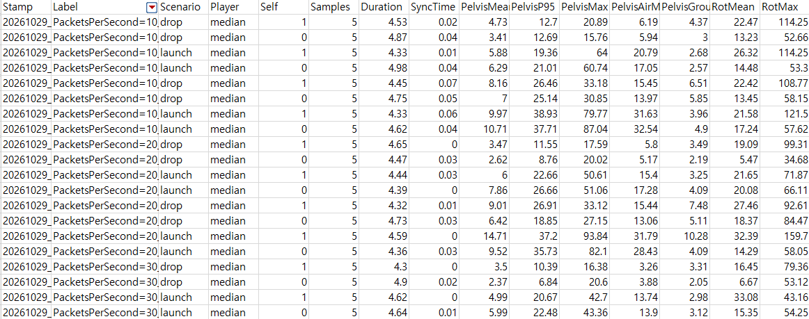

## [Trombone Rumble (2025.09 ~ 2026.10)](https://store.steampowered.com/app/4418320/Trombone_Rumble/)

---

### **래그돌 위치 동기화**

> **UE가 지원하지 않는 래그돌 위치 동기화를 직접 구현. 쓰러져 있는 동안 서버와의 골반 차이를 Latency 0에서 평균 3.0cm,
> Latency 100ms, Packet Loss 2%에서도 5.4cm로 유지**

<br/>
  
#### **상황**

트럼본 럼블은 리슨 서버 기반 멀티플레이 게임이고, 특정 상황에서 날아가 래그돌이 된다. 래그돌이 되고 몇 초가 지나면 그 
자리에서 자연스럽게 일어나 다시 움직여야 한다. 죽어서 래그돌이 되는 게임이라면 다시 일어날 일이 없으니 위치가 조금 
어긋나도 상관없지만, 트럼본 럼블은 일어난다.

래그돌 위치는 두 군데서 어긋나고 둘 다 일어나는 순간 순간이동하는 것처럼 눈에 보여진다.
- 캐릭터 안에서는 캡슐과 메시가 어긋난다. (문제 1)
- 서버와 클라 사이에는 같은 캐릭터의 메시가 어긋난다. (문제 2~4)

<br/>

#### **문제 1. 일어날 때 메시가 캡슐 자리로 순간이동한다**

캐릭터가 래그돌에 진입하면 캡슐은 이동(CMC)과 충돌을 끄고, 메시만 물리 시뮬레이션을 켠다. 캡슐은 그 자리에 가만히 있고,
메시가 물리로 움직인다. 일어나면 결국 메시의 물리 시뮬레이션을 끄고 메시를 캡슐 기준 원래 자리로 되돌리는데, 둘의
위치가 다르면 이 순간 메시가 캡슐의 위치로 순간이동하게 된다.

**선택**

이를 맞춰주기 위한 두 가지 방법이 있었다.

1. 래그돌 중에도 캡슐을 계속 메시 위치로 따라가게 하기
2. **래그돌 중에는 캡슐을 가만히 두고, 일어날 때 캡슐과 메시를 한 위치에 맞추기**

중요한 건 래그돌이 끝날 때 캡슐과 메시의 위치가 같아야 하는거니, 매 틱 연산하지 않고 일어날 때 한 번만 연산하는 2번
방법을 선택했다. 기준 위치는 서버가 자기 골반 아래 바닥을 찾아 정하고, 서버와 클라 모두 캡슐을 옮긴 뒤 메시도 같은 XY로
옮기고 0.2초 동안 기상 애니메이션으로 블렌드한다.

이때 캡슐은 `TeleportPhysics`가 아니라 `None`으로 옮긴다. `TeleportPhysics`는 붙어 있는 메시까지 텔레포트를 전달해 아직
시뮬레이션 중인 래그돌 바디를 강제로 옮기고, 그 순간 메시가 튄다.

**결과**

서버에서는 이걸로 캡슐과 메시가 같은 자리에서 일어난다. 하지만 클라의 메시가 서버 골반과 다른 곳에 누워 있었다면, 메시를
옮기는 순간 그 차이만큼 순간이동한다. 남은 문제는 서버와 클라의 메시를 얼마나 가깝게 맞추느냐였다.

<br/>

#### **문제 2. 래그돌의 물리 상태는 클라에 가지 않는다**

UE의 물리 리플리케이션은 **루트 컴포넌트가 물리 시뮬레이션 중일 때만** 그 루트 컴포넌트의 위치와 속도를 클라에 보낸다.
캐릭터는 루트가 캡슐이고 래그돌은 그 아래 스켈레탈 메시라서, 래그돌의 물리 상태는 클라에 가지 않는다. 그래서 서버와 
클라는 같은 충격을 받고 같이 래그돌을 시작하지만 각자 물리로 메시가 움직이고, 메시는 서로 다른 곳으로 이동한다. 이걸
맞추려면 무엇을 보낼지부터 정해야 했다.

**선택 1. 모든 본 대신 골반 하나**

모든 본의 상태를 보낼 수도 있지만, 바디는 관절로 이어져 있으니 골반이 움직이면 팔다리는 물리가 알아서 끌고 온다. 그리고
팔 다리의 위치가 조금 어긋나는 건 유저 경험에 큰 문제가 되지 않는다고 생각했다. 그래서 서버는 골반 하나의 상태만 보낸다.

```cpp
USTRUCT(BlueprintType)
struct FRagdollNetState
{
	GENERATED_BODY()

	UPROPERTY()
	FVector_NetQuantize PelvisLocation = FVector::ZeroVector;

	UPROPERTY()
	FVector_NetQuantize PelvisVelocity = FVector::ZeroVector;

	UPROPERTY()
	FQuat PelvisRotation = FQuat::Identity;

	UPROPERTY()
	FVector_NetQuantize100 PelvisAngularVelocity = FVector::ZeroVector;

	UPROPERTY()
	float Timestamp = 0.0f;
};
```

위치만이 아니라 속도와 각속도까지 보내는 이유는 뒤의 외삽과 속도 보정(문제 3)에 쓰기 때문이다.

**선택 2. RPC 대신 프로퍼티 리플리케이션**

클라는 가장 최근에 받은 골반 상태 하나로 외삽한다(문제 3). 지난 상태를 버퍼에 모아 두고 보간하는 방식이라면 중간 값도
필요하지만, 외삽은 새 값이 오는 순간 이전 값을 쓸 일이 없기에 최신 값 하나만 필요하다.

이 기준으로 보면 순서와 도착을 보장하는 Reliable RPC는 맞지 않았다. Packet Loss가 나면 재전송될 때까지 뒤의 새 값이
기다려야 하기 때문이다. Unreliable Multicast로도 동작은 하지만 매번 구조체 전체를 보낸다. 그래서 바뀐 멤버만 보내고, 
Packet Loss가 나면 그 시점의 최신 값을 다시 보내는 프로퍼티 리플리케이션을 택했다.

서버는 래그돌 중에만 컴포넌트 Tick을 켜고, 초당 30번 골반 상태를 갱신한다. 30번은 처음 구현할 때 정한 값이라, 나중에
측정 툴로 10, 20, 30, 60번을 비교해 봤다. 날아가는 동안의 오차는 30번까지 횟수를 늘릴수록 줄었고, 60번으로 올려도
나아지지 않아서 30번을 그대로 두었다.

{: width="800" .center}
_측정 csv_

**선택 3. 벡터는 NetQuantize로**

`FVector`를 그대로 보내면 양자화 없이 double 세 개(192비트)가 간다. 위치와 속도는 cm, cm/s 단위라 정수로 잘라도 오차가
최대 0.5cm로 측정한 오차에 비하면 무시할 만해서, 성분당 최대 20비트인 `FVector_NetQuantize`를 썼다. 각속도도 처음에는
같은 타입이었는데, 단위가 rad/s라 정수로 잘리면서 회전 속도가 축마다 최대 초당 29도씩 틀어지는 걸 나중에 확인하고 소수
둘째 자리까지 남는 `FVector_NetQuantize100`으로 바꿨다.

**결과**

이제 서버 래그돌의 골반 상태가 초당 30번 클라에 간다. 서버와 클라가 같은 골반을 기준으로 삼게 됐고, 클라는 이 상태를
따라가기만 하면 된다(문제 3).

<br/>

#### **문제 3. 받은 상태는 늘 과거다**

클라가 받은 상태는 언제나 패킷이 오는 동안만큼 지난 과거다. 보간은 이 과거 상태 사이를 매끄럽게 이어 주지만, 결국 늘
늦게 따라간다.

**선택**

래그돌은 플레이어가 직접 조작하는 게 아니라서 조금 늦어도 티가 덜 나기에 보간으로도 충분할 수 있었다. 그래도 일어날 
때의 순간이동을 줄이려면 **지금** 서버 메시가 있는 곳에 맞춰야 해서, 늦은 만큼 앞으로 예측하는 외삽을 선택했다.

상태가 만들어진 뒤 흐른 시간을 패킷 나이라 하고, 서버 골반 위치에 속도와 패킷 나이를 곱한 만큼 더해 목표로 삼는다.

```cpp
FVector TargetPelvisLoc = FVector(ServerRagdollState.PelvisLocation) + ServerVelocity * PacketAge;
if (bAirborne)
{
	TargetPelvisLoc.Z += 0.5f * World->GetGravityZ() * PacketAge * PacketAge;
}
```

공중에서는 그 시간 동안 떨어진 거리(1/2gt^2, 중력 항)도 더하고, 회전도 각속도로 같은 시간만큼 외삽한다.
다만 외삽은 오래 할수록 크게 빗나가서, 최대 외삽 시간을 **0.25초**로 설정했다.

이렇게 구한 목표로 골반을 옮길 때, 위치를 바로 덮어쓰면 골반만 순간이동하고 팔다리는 남아 관절이 튀기 때문에, 위치 대신
**골반 속도**를 바꿔 물리가 메시 전체를 함께 옮기게 했다.

```cpp
FVector PositionCorrection = (TargetPelvisLoc - CurrentPelvisLoc) * TrackingIntensity;
PositionCorrection = PositionCorrection.GetClampedToMaxSize(MaxCorrectionSpeed);

const FVector TargetVelocity = ServerVelocity + PositionCorrection;
const FVector NewVelocity = FMath::VInterpTo(CurrentVelocity, TargetVelocity, DeltaTime, VelocityInterpSpeed);
OwnerMesh->SetPhysicsLinearVelocity(NewVelocity, false, TromboneBones::Pelvis);
```

목표 속도는 서버 속도에 외삽한 목표와 지금 골반 사이의 거리에 비례하는 보정 속도를 더한 값이다. 보정 속도에는 상한을
둬서, 크게 벌어져도 너무 세게 당기지 않는다. 회전도 같은 방식으로, 회전 오차를 축과 각도로 바꿔 각속도로 끌어당긴다.

다만 바닥에서는 마찰과 충돌 때문에 속도로 한 예측이 자주 빗나가서, 골반 아래가 바닥에 닿아 있으면 중력 항을 빼고 보정
속도의 아래쪽 성분도 버린다. 바닥 쪽으로 당기면 메시가 바닥을 파고들기 때문이다.

**결과**

외삽은 패킷 나이만큼 앞을 내다보는 것이라, 나이가 틀리면 그만큼 빗나간다. 그런데 처음 구현에서는 이 나이를 실제보다 짧게
재고 있었다.

<br/>

#### **문제 4. 패킷 나이가 실제보다 짧게 잡혔다**

처음에는 상태에 찍힌 서버 시각과, 클라가 추정한 지금 서버 시각(`GetServerWorldTimeSeconds`)의 차이에 RTT의 절반을 더해
나이를 쟀다. 그런데 측정 툴로 추정 나이와 실제 나이를 비교해 보니, 이렇게 잰 나이는 실제보다 30ms 가까이 짧았다. Latency
0에서는 프레임의 73%에서 나이가 음수로 나와 0으로 잘리면서 외삽이 거의 꺼져 있었다.

원인은 엔진의 서버 시각 추정에 있었다. 서버는 0.1초마다 시각 값을 갱신하지만 게임스테이트는 이와 맞춰지지 않은 박자로
복제되어, 클라가 받는 서버 시각이 이미 0~100ms 지난 값이었다. 엔진은 이 값을 그대로 지금 서버 시각으로 쓰는데, RTT의
절반은 전송 시간만 메우므로 지난 만큼은 그대로 남았다.

**해결**

해결 방법을 여러 가지 찾아봤고, 아래와 같은 방법들이 있었다.

1. 엔진 설정을 바꿔 서버 시각을 더 자주 갱신하고, 게임스테이트를 더 자주 복제하기
2. RPC로 서버 시각을 직접 묻고, 왕복 시간으로 시차를 계산하는 자체 시계 동기화
3. **서버 시각을 쓰지 않고, 상태를 받은 뒤 흐른 시간에 RTT의 절반을 더하기**

1번은 코드를 거의 그대로 둘 수 있지만, 받은 값이 지나 있는 폭이 줄어들 뿐 없어지지는 않고 게임스테이트 복제만 잦아진다.
2번은 주기적으로 다시 맞추고 튀는 값을 걸러 내는 것까지 만들어야 하고, 시차를 계산할 때 결국 RTT의 절반에 기대는 건
마찬가지다.

외삽에 필요한 것은 서버 시각 자체가 아니라 "상태가 만들어진 뒤 흐른 시간"뿐이다. 3번은 이를 클라 시계로 직접 재므로 서버
시각을 추정할 필요가 아예 없고, 남는 근사는 다른 방법들과 같은 RTT의 절반 하나뿐이다. 정확도에서 밀리지 않으면서 몇
줄이면 끝나 3번을 골랐다.

```cpp
PacketAge = static_cast<float>(FApp::GetCurrentTime() - StateReceivedRealTime);
PacketAge += LocalPlayerState->GetPingInMilliseconds() * 0.001f * 0.5f;
PacketAge = FMath::Clamp(PacketAge, 0.0f, MaxExtrapolationTime);
```

**결과**

지금 방식으로 잰 나이는 실제와 5ms 안쪽으로만 차이 나고, Latency 0에서도 0으로 잘리는 프레임이 없다. Latency 100ms,
Packet Loss 2%에서 이 수정만 예전 방식으로 되돌리면 날아가는 동안의 평균 오차가 7.8cm 커진다.

<br/>

#### **최종 결과**

일어날 때 순간이동하는 거리는 일어나기 직전, 쓰러져 있는 동안 서버와 클라의 골반이 얼마나 떨어져 있느냐로 정해진다.
PIE에서 서버 골반을 정답으로, 래그돌을 20번씩 반복해 잰 중앙값을 평균한 값이다.

| 서버와의 골반 차이    | Latency 0 | Latency 100ms(핑 약 200ms), Packet Loss 2% |
|-----------------------|-----------|--------------------------------------------|
| 쓰러져 있는 동안 평균 | 3.0cm     | 5.4cm                                      |
| 날아가는 동안 평균    | 9.0cm     | 21.4cm                                     |

<br/>
